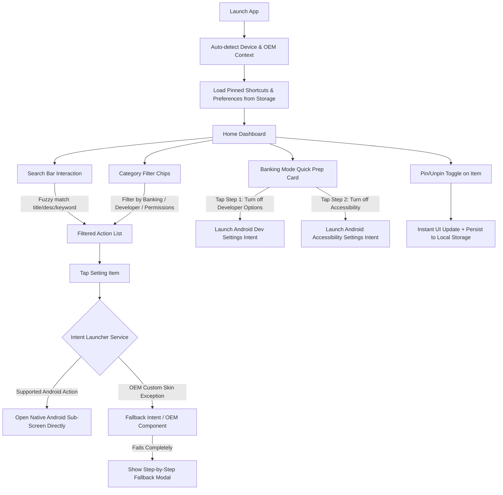

# App Flow & Navigation Architecture

## Project: Redirect (Android Deep Settings Utility)

---

## 1. High-Level User Journey Diagram

---

## 2. Detailed Screen Flows

### 2.1 Screen 1: Home Dashboard (`HomeScreen`)
* **Header:**
  * App Name (`Redirect`)
  * Device Badge (e.g., `Samsung One UI • Android 14`)
  * Settings / About icon.
* **Hero Banner: "Banking & Payment Quick Prep"**
  * Subtext: *"Disable these 2 settings to pass Google Pay / PhonePe / Bank checks."*
  * Quick 1-tap launcher for:
    1. **Developer Options**
    2. **Accessibility Services**
* **Quick Access / Pinned Section (Horizontal Carousel or Grid):**
  * Displays user's starred settings cards for ultra-fast access.
* **Search Bar & Category Filter Bar:**
  * Sticky search bar with clear button.
  * Filter pills: `All`, `Banking Prep`, `Developer`, `Special Access`, `System`.
* **Master Settings List:**
  * List of all indexed deep settings items.
  * Each item includes:
    * Left icon with custom themed background.
    * Title & clear description.
    * Pin button (toggle star).
    * Launch arrow button.

---

### 2.2 Screen 2: Banking Assistant Flow (`BankingPrepModal` / Tab)
* A streamlined 2-step wizard designed for quick execution:
  * **Step 1: Check Developer Options / USB Debugging**
    * Button: *Open Developer Options* -> Takes user directly to the developer options screen.
  * **Step 2: Check Active Accessibility Services**
    * Button: *Open Accessibility Services* -> Takes user directly to the accessibility settings screen.
  * **Step 3: Test / Return Confirmation**
    * Re-entry helper with tips on common banking apps (HDFC, SBI, ICICI, GPay, PhonePe).

---

### 2.3 Screen 3: Device Diagnostics & Fallbacks (`DiagnosticsModal`)
* Displays device hardware info:
  * Manufacturer (Samsung, Xiaomi, Google, etc.)
  * OS Version & API Level.
* Fallback Intent Tester: Allows testing alternative intent routes if a specific OEM altered standard Android actions.

---

## 3. Intent Dispatch Strategy

1. **Primary Route:** Standard Android `android.provider.Settings` action via `expo-intent-launcher`.
2. **Secondary Route (OEM Fallback):** If `ActivityNotFoundException` is caught:
   * Match against OEM table (e.g., Xiaomi MIUI Security Center activities).
   * Launch explicit component (`packageName`, `className`).
3. **Tertiary Route:** If all intents fail, launch root `Settings` (`android.settings.SETTINGS`) and show the user the precise search keyword to type.
